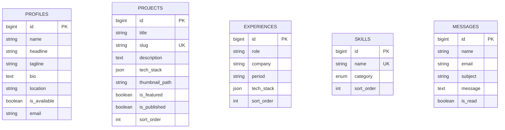

# 🏛️ Nizar Khan Portfolio — Master Architecture (`folio-app`)
> Disegerakkan 22 November 2026 · Status: Semua Modul Siap · Kod ialah kebenaran.

## 0. Kamus Placeholder
| Placeholder | Nilai |
| :--- | :--- |
| `NAMA_PRODUK` | Nizar Khan Portfolio |
| `NAMA_KOD` | `folio-app` |
| `STACK` | PHP 8.4 + Laravel 13 + Livewire 4 + Flux UI + Alpine.js + Tailwind CSS v4 + MySQL 8 |
| `BAHASA_UI` | 100% Bahasa Inggeris Profesional |
| `TENANCY` | Single-Owner (Tiada `user_id` pada 5 jadual portfolio) |
| `ENTITI` | `Profile`, `Project`, `Experience`, `Skill`, `Message` |

## 1. Technical Overview
- **Base:** Official Laravel 13 Livewire Starter Kit (Auth, 2FA, Passkeys, Settings & Sidebar Layout built-in).
- **Database:** MySQL 8.0+ (InnoDB, `utf8mb4_unicode_ci`) — 5 Jadual Portfolio Teras tanpa `user_id`.
- **Architecture:**
  1. **Public Single-Page Portfolio (`/`):** `App\Livewire\PublicPortfolio` menggunakan `resources/views/layouts/public.blade.php` (Tema Cyberpunk HUD Light/Dark, SEO JSON-LD, Navbar + scroll progress bar + menu mobile, Hero `NETRUNNER_ID // 001`, grid 3-lajur maks 6 projek featured + modal `All Projects` + native top-layer `<dialog>` `Show Details`, Experience timeline, Skills capability matrix, dan Contact form).
  2. **Admin Dashboard (`/dashboard` & `/admin/*`):** Menggunakan layout `resources/views/layouts/app.blade.php` & `resources/views/layouts/app/sidebar.blade.php` dengan tema Cyberpunk HUD yang seragam.
  3. **Auth (`/sys-console/*`):** Menggunakan `resources/views/layouts/auth/simple.blade.php` (dikunci ke mod gelap `dark` + `h-dvh overflow-hidden`, laluan `/register` dimatikan).

## 2. ERD Ringkas

## 3. Kamus Data (5 Standalone Core Tables)
| Jadual | Tujuan | Medan Utama | Indeks |
| :--- | :--- | :--- | :--- |
| `profiles` | Rekod tunggal (Singleton `id = 1`) profil & hero | `name`, `headline`, `tagline`, `bio`, `location`, `is_available`, `email`, `github_url`, `linkedin_url`, `resume_url`, `resume_path`, `avatar_path`, `banner_path` | Primary `id` |
| `projects` | Projek portfolio & showcase | `title`, `slug` (unik), `description`, `tech_stack` (JSON), `thumbnail_path`, `demo_url`, `repo_url`, `is_featured`, `is_published`, `sort_order` | `[is_published, sort_order]` |
| `experiences` | Garis masa pengalaman kerja | `role`, `company`, `location`, `period`, `description`, `tech_stack` (JSON), `sort_order` | `[sort_order]` |
| `skills` | Kemahiran teknikal mengikut kategori | `name` (unik), `category` (`backend`/`frontend`/`database`/`devops_tools`), `sort_order` | `[category, sort_order]` |
| `messages` | Peti masuk mesej borang Contact | `name`, `email`, `subject`, `message`, `is_read` | `[is_read, created_at]` |

## 4. Business Rules & SOP
1. **Singleton Profile:** `Profile::current()` sentiasa mengambil/mencipta rekod `id = 1`.
2. **Had Projek Featured:** Maksimum 6 projek boleh ditanda `is_featured = true` (dikawal dalam `ProjectManager`). Paparan awam mengambil maksimum 6 projek featured (`take(6)`).
3. **Anti-Spam Contact Email:** `Profile.email` membenarkan format `[at]`. Paparan awam hanya memautkan `mailto:` jika terdapat `@`; penghantaran notifikasi e-mel dalam `PublicPortfolio::submitContact()` menukar `[at]` → `@` secara dalaman sebelum `Mail::raw()`.
4. **Top-Layer Nested Modal:** Butang `Show Details` dalam modal `All Projects` membuka `<dialog x-ref="detailDialog">` melalui `.showModal()` supaya backdrop menutup keseluruhan viewport dan scroll luar dikunci.
5. **Reverse Proxy & HTTPS (`bootstrap/app.php`):** `$middleware->trustProxies(at: '*');` diaktifkan supaya Livewire, Flux, dan `url()` sentiasa menjana URL `https://` di belakang Cloudflare Tunnel atau Nginx.

## 5. Peta Laluan & Komponen Livewire (`routes/web.php`)
- `GET /` → `App\Livewire\PublicPortfolio::class` (`name('home')`)
- `GET /sitemap.xml` → XML dinamik (`name('sitemap')`)
- `GET /robots.txt` → Teks dinamik dengan `url('/sitemap.xml')` (`name('robots')`)
- `GET /sys-console/login` → Laluan Fortify (prefix `sys-console`; `/register` dimatikan)
- `GET /dashboard` → `resources/views/dashboard.blade.php` (`name('dashboard')`)
- `GET /admin/profile` → `App\Livewire\Admin\ProfileEditor::class` (`name('admin.profile')`)
- `GET /admin/projects` → `App\Livewire\Admin\ProjectManager::class` (`name('admin.projects')`)
- `GET /admin/experience-skills` → `App\Livewire\Admin\ExperienceSkillManager::class` (`name('admin.experience-skills')`)
- `GET /admin/messages` → `App\Livewire\Admin\MessageInbox::class` (`name('admin.messages')`)
- `/settings/*` → Laluan tetapan Livewire Starter Kit dikekalkan sepenuhnya.

## 6. Verification & Quality Gates
- Asset Build: `npm run build` (Vite + Tailwind CSS v4)
- Code Style: `composer lint:check` (Laravel Pint)
- Static Analysis: `composer types:check` (Larastan / PHPStan)
- Test Suite: `php artisan test` (PHPUnit)
